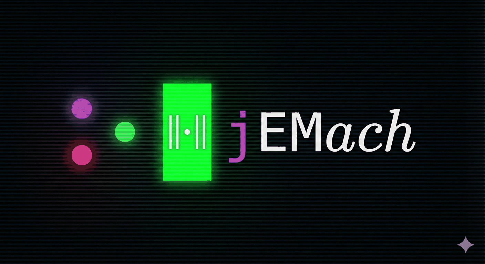

# jEMach



A high-performance, Data-Oriented **Julia Workspace Assistant & REPL Monitor** with a multi-terminal interactive TUI (**Ghostty**, **Kitty**, **tmux**, **Zellij**, **Rex**) and native Zig IPC broker.

Inspect variables, dataframes, matrices, composite structs, and package dependencies in real time alongside your Julia REPL — completely standalone, with zero Neovim or external package requirements.

---

## Architecture Overview

`jEMach` is built around **Data-Oriented Design (DoD)** principles for minimum latency, zero GC pressure, and optimal cache locality:

- **Julia Engine (`src/jEMach.jl`)**: Asynchronous background introspection task organizing workspace symbols into a Struct-of-Arrays (SoA) columnar table (`WorkspaceTable`), plus a full-duplex UNIX domain socket server for direct REPL evaluation and `LineEdit` buffer injection without external multiplexer dependencies.
- **Multi-Terminal TUI (`scripts/jl_tui.lua`)**: Standalone LuaJIT terminal UI connecting over UNIX domain sockets (`/tmp/jemach_<project>.sock`). Features DEC Mode 2026 Synchronized Output, Alternate Screen Buffer, Kitty/Ghostty CSI-u keyboard protocol support, zero-fork FFI `ioctl(TIOCGWINSZ)` resize detection, and 0.0% idle CPU usage.
- **Native Zig Broker (`zig/`)**: Ultra-fast bidirectional fan-out IPC broker and SoA multi-array structures (`std.MultiArrayList`) for high-throughput zero-copy event streaming.

---

## Installation

### In Julia

```julia
julia .
]
# pkg>
add https://github.com/kitajusSus/jEMach

# or using Pkg API:
using Pkg
Pkg.add(url="https://github.com/kitajusSus/jEMach")
```

---

## Quick Start (Ghostty / Kitty / tmux / Zellij / Rex)

### Option 1: Automatic Split / Window from Julia REPL (Recommended)

1. Start your Julia REPL in **Ghostty**, **Kitty**, **tmux**, **Zellij**, or **Rex**:
   ```bash
   julia -t auto --project=.
   ```
2. Load and start `jEMach`:
   ```julia
   using jEMach
   jEMach.start()                 # Auto-detects active multiplexer/terminal and opens TUI
   # Or explicitly specify a backend (:auto, :ghostty, :kitty, :tmux, :zellij, :rex):
   jEMach.start(backend=:ghostty)
   ```
3. When finished:
   ```julia
   jEMach.stop()                  # Stops the watcher and closes the TUI pane/window automatically
   ```

---

### Option 2: Manual Split or Inline Launch via CLI (`jl-assist`)

- **Inside Ghostty / Kitty / Any Native Split**:
  1. Open a split in your terminal (e.g., `Ctrl+Shift+O` in **Ghostty** for `new_split:right`) and run:
     ```bash
     ./scripts/jl-assist          # Auto-attaches inline when a jEMach session is active!
     # or explicitly inline:
     ./scripts/jl-assist -i
     ```
- **Inside tmux / Zellij / Kitty Remote Control / Rex**:
  ```bash
  ./scripts/jl-assist            # Automatically spawns a side split for the detected backend
  ```

### Supported Terminal & Multiplexer Backends

| Backend                   | Auto-Detection                            | Split / Launch Mechanism                                                                                  | Bidirectional REPL Sync                         |
| :------------------------ | :---------------------------------------- | :-------------------------------------------------------------------------------------------------------- | :---------------------------------------------- |
| **`tmux`**                | `$TMUX`                                   | `tmux split-window -h`                                                                                    | UNIX Socket RPC + `send-keys` fallback          |
| **`zellij`**              | `$ZELLIJ` / `$ZELLIJ_SESSION_NAME`        | `zellij run --direction right --close-on-exit`                                                            | UNIX Socket RPC (`LineEdit` + `Main` eval)      |
| **`kitty`**               | `$KITTY_WINDOW_ID` / `xterm-kitty`        | `kitten @ launch --location=vsplit` (or companion window)                                                 | UNIX Socket RPC + `kitten @ send-text` fallback |
| **`ghostty`**             | `$TERM_PROGRAM=ghostty` / `xterm-ghostty` | Native split (`Ctrl+Shift+O` + `jl-assist`) or `ghostty` companion window/tab (`JEMACH_GHOSTTY_MODE=tab`) | UNIX Socket RPC (`LineEdit` + `Main` eval)      |
| **`rex`** _(Ghostty mux)_ | `$REX_SESSION` / `$REX` / `$GHOSTTY_REX`  | `rex pane split` / `rex split-window` / `$JEMACH_REX_SPLIT_CMD`                                           | UNIX Socket RPC + `rex send-keys` fallback      |

---

### Auto-Hooking on Startup (Optional)

To automatically start `jEMach` whenever an interactive Julia REPL launches, add this to `~/.julia/config/startup.jl`:

```julia
if isinteractive()
    try
        using jEMach
    catch
    end
end
```

See [docs/src/startup.md](docs/src/startup.md) for advanced configuration.

---

## TUI Tabs & Navigation

The TUI provides 4 dedicated panels accessible via `1`, `2`, `3`, `4` or `Tab`:

- **`[1] Workspace`**: Real-time Data-Oriented tree view of variables, matrices, dataframes, structs, and modules.
- **`[2] History`**: REPL session command log with multi-select checkboxes (`Space`) to package commands into reusable procedures (`p`).
- **`[3] Procedures`**: Library of saved procedures with live split-view source code preview, run execution benchmarks (`Enter`), and REPL parameter editing (`e`).
- **`[4] Packages`**: Interactive project package manager (`a` add, `d` remove, `u` update).

---

## Reusable Procedures & REPL History

Turn your experimental REPL commands into parameterized, reproducible procedures with automatic AST variable analysis:

### 1. From the Interactive TUI (`jl-assist`)

1. Press `2` to switch to **History**.
2. Press `Space` to toggle `[x]` on the commands you want in your procedure.
3. Press `p` (**Make Procedure**): an inline modal dialog will prompt for the procedure name.
4. Hit `Enter`: `jEMach` extracts free variables, sets default values from your session, generates `procedures/<name>.jl`, and automatically loads it!
5. In **`[3] Procedures`**, hit `Enter` to run with profiling or `e` to edit arguments in the REPL.

### 2. Directly in Julia REPL

`jEMach` also works natively inside the Julia REPL — even without the TUI sidecar:

#### `jemach>` REPL Mode & Shortcuts

- Type **`}`** on an empty prompt (or press **`Alt+m`**) to enter the **`jemach>`** REPL mode (with full **Tab completion** for subcommands, procedure names, and workspace variables; `Backspace` or `Ctrl+C` exits).
- **`Alt+j`**: Insert/browse a procedure call straight into the current `julia>` prompt.
- **`Alt+r`**: Start or stop procedure recording (prompt dynamically switches to `⏺ [rec: name] julia> ` while recording).
- **`↑` / `↓` history sync**: Commands executed from the TUI sidecar (`Enter` in History/Procedures) are appended to Julia's live in-memory `REPLHistoryProvider`, so pressing `↑` recalls them right away.
- **Auto-loaded procedures**: Existing `procedures/*.jl` files are automatically loaded into `Main` on `using jEMach` (disable with `ENV["JEMACH_AUTOLOAD"] = "0"`).

```julia
using jEMach

# Inside jemach> mode (press '}' on empty prompt or Alt+m):
# jemach> ls                                  # List procedures
# jemach> ws [query]                          # Workspace summary table
# jemach> inspect my_var                      # Variable type, size, fields, methods
# jemach> show check_sample                   # Source code, signature & timings
# jemach> run check_sample(10)                # Run procedure with args
# jemach> make my_proc 4                      # Package last 4 commands
# jemach> rec my_flow                         # Start/stop recording (or Alt+r)

# Or via macros / functions anywhere in julia>:
@jemach ls
@jemach run check_sample(x)
@inspect my_var
workspace("matrix")

# Option A: Extract last N commands into a parameterized procedure
jEMach.make_procedure(:check_sample, last=4)

# Option B: Record commands interactively
jEMach.record(:verify_matrix)
A = rand(10, 10)
A = A + A'
e = eigen(A)
all(e.values .> -1e-5)
jEMach.record_stop()

# Reload/sync procedures/*.jl manually
jEMach.autoload_procedures!()

# List all discovered procedures (with optional search query)
jEMach.list_procedures()
jEMach.list_procedures("matrix")
jEMach.find_procedures("sample")
```

---

## TUI Keybindings

| Key                      | Context    | Action                                                                        |
| :----------------------- | :--------- | :---------------------------------------------------------------------------- |
| `/`                      | Global     | **Search & Live Filter** (procedures, workspace variables, history, packages) |
| `Esc` / `x`              | Global     | Clear search filter and restore full list                                     |
| `1` / `2` / `3` / `4`    | Global     | Jump directly to Workspace / History / Procedures / Packages                  |
| `Tab` / `]` / `[`        | Global     | Cycle to next / previous tab                                                  |
| `j` / `k` (or `↓` / `↑`) | Global     | Move cursor down / up                                                         |
| `Space`                  | History    | Toggle selection `[x]` / `[ ]` on command                                     |
| `a`                      | History    | Toggle select all / clear all                                                 |
| `p`                      | History    | **Make Procedure** from selected commands (opens modal prompt)                |
| `↵` (Enter)              | History    | Send highlighted command to REPL                                              |
| `↵` (Enter)              | Procedures | Run highlighted procedure with benchmark profiling                            |
| `e`                      | Procedures | Paste `<proc_name>()` into REPL line to customize parameters                  |
| `d`                      | Procedures | Delete procedure file from disk (with in-TUI confirmation)                    |
| `r`                      | Procedures | Reload procedure definitions from disk                                        |
| `l` / `↵` (Enter)        | Workspace  | Expand node **or** evaluate `println(var)` in REPL                            |
| `h` (or `←`)             | Workspace  | Collapse node / jump to parent                                                |
| `i`                      | Workspace  | Inspect variable details, methods, and creation history                       |
| `e`                      | Workspace  | Insert variable expression directly into REPL command line                    |
| `d`                      | Workspace  | Hide item from view                                                           |
| `D`                      | Workspace  | Restore all hidden items                                                      |
| `s`                      | Workspace  | Save clean reproducible session script                                        |
| `a` / `d` / `u`          | Packages   | Add / Remove / Update package (in-TUI dialogs)                                |
| `c`                      | Global     | Clear REPL screen (`Ctrl-L`)                                                  |
| `q` / `Ctrl-C`           | Global     | Quit assistant                                                                |

---

## Tree & Complex Type Introspection

`jEMach` includes specialized introspection extractors for:

- **DataFrames & Tables.jl**: Column names, row counts, and column types.
- **1D Arrays & 2D Matrices**: Dimensions, element types, and value slices.
- **Dictionaries & Sets**: Key-value pairs and entry expressions.
- **Tuples & NamedTuples**: Indexed and named member access.
- **Composite Structs**: Real-time field resolution via `fieldnames(T)` and chained accessors.

```
▼ Main
    df            DataFrame (100 rows)   100×2 DataFrame
    ├─ :colA      Vector{Int64} (100 rows) [1, 2, 3...]
    └─ :colB      Vector{Float64} (100 rows) [1.0, 2.0...]
    x             Int64                  42
    my_func       Function               (2 methods)
▶ LoadedPackage   Module                 [collapsed — press l to expand]
```

---

## CLI Options (`jl-assist`)

```
./scripts/jl-assist [-b BACKEND] [-i] [-p PANE_ID] [-w WIDTH] [-s SOCKET] [-d STATE] [-f]

  -b BACKEND   Backend override: auto, tmux, zellij, kitty, ghostty, rex, inline (default: auto)
  -i           Run TUI inline directly in the current terminal/split
  -p PANE_ID   Target pane/window running Julia (auto-detected by default)
  -w WIDTH     Width of the TUI pane/window in columns (default: 65)
  -s SOCKET    Custom UNIX socket path
  -d STATE     Custom state JSON file path
  -f           Force a new TUI pane/window even if one is already open
```

---

## Native Zig Accelerator & Broker (`zig/`)

`jEMach` includes a native Zig shared library (`libjemach_native`) with SIMD JSON string escaping and single-pass `repl_history.jl` block parsing (with automatic pure-Julia fallback if `zig` is not installed), as well as a standalone IPC broker (`jemach-broker`):

```bash
# Built automatically when Zig is installed via Julia:
julia -e 'using Pkg; Pkg.build("jEMach")'

# Or directly in zig/:
cd zig
zig build test                       # Runs Zig DoD & native accelerator unit tests
zig build -Doptimize=ReleaseFast     # Builds libjemach_native + jemach-broker
```

---

## System Requirements

- **Julia** >= 1.10
- **luajit** (`sudo pacman -S luajit` on Arch Linux, `sudo apt install luajit` on Ubuntu/Debian)
- **Terminal / Multiplexer**: Any of **Ghostty**, **Kitty**, **tmux** (>= 3.0), **Zellij**, **Rex**, or any ANSI/VT100 terminal emulator
